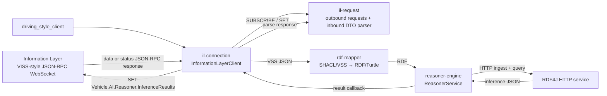
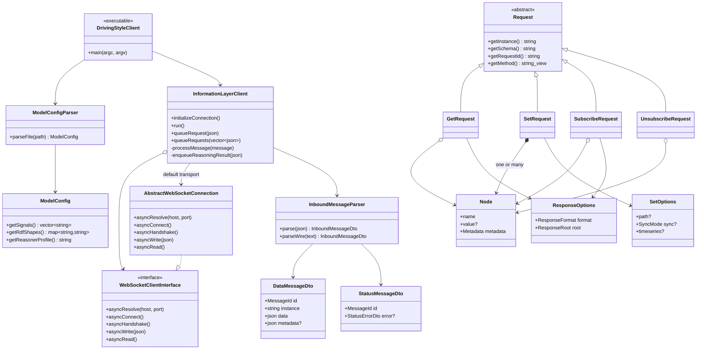
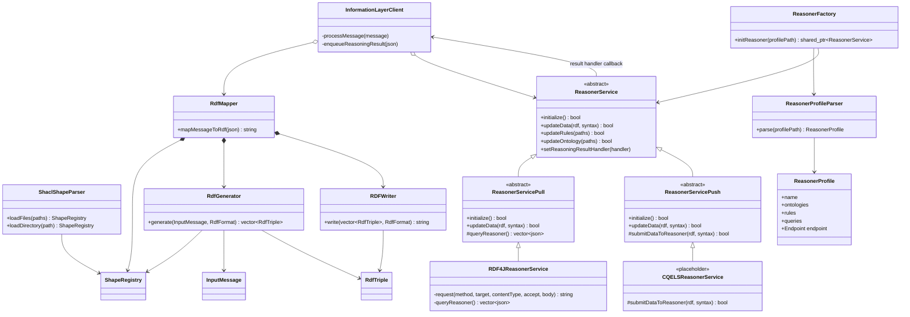

# Knowledge Layer architecture

## Runtime data flow

The maintained runtime uses the pull-based `RDF4JReasonerService`. The CQELS
class is a push-based extension point and currently a placeholder.

## Application, connection, and IL request classes

`il-request` is the module and CMake target name. The public C++ include path
and namespace stay `il_request`, because hyphens are not valid C++ identifiers.

## RDF mapping and reasoning classes

## Ownership rules

- `InformationLayerClient` owns the runtime orchestration: WebSocket lifecycle,
  request/reply queues, `RdfMapper`, and one `ReasonerService` instance.
- `RdfMapper` owns parsed shape state and is stateless per input message.
- `ReasonerService` does not own the client. It publishes normalized inference
  JSON through the callback that the client supplies.
- `il-request` is DTO/serialization only; it does not open sockets or retain
  subscriptions.
